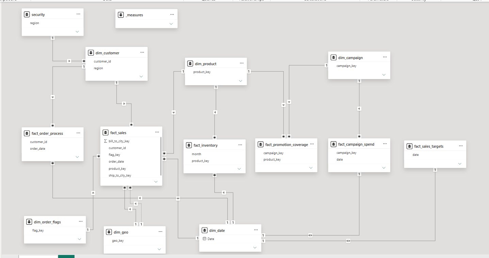

# Power BI Data Modeling

A Power BI data-modeling project built from the supplied Excel data source. The
repository contains the source workbook, the completed Power BI report, and a
snapshot of the final model layout.

## Project contents

| Path | Description |
| --- | --- |
| [`Report.pbix`](./Report.pbix) | Completed Power BI report and semantic model |
| [`data/dataset.xlsx`](./data/dataset.xlsx) | Excel workbook used as the source dataset |
| [`Fina_Data_model.png`](./Fina_Data_model.png) | Exported image of the final Power BI data model |

## Final data model

The final model uses shared dimensions around business-process fact tables.
This keeps filtering and reporting consistent across sales, inventory,
campaign, and order-process analysis.

### Model areas

**Dimensions**

- `dim_customer` - customer and region context
- `dim_product` - product context
- `dim_campaign` - campaign context
- `dim_date` - common date filtering
- `dim_geo` - geographic keys
- `dim_order_flags` - order status/flag attributes
- `security` - regional security mapping
- `_measures` - centralized measures used by the report

**Facts**

- `fact_sales` - sales transactions
- `fact_inventory` - product inventory by month
- `fact_campaign_spend` - campaign spending by date
- `fact_promotion_coverage` - campaign/product promotion coverage
- `fact_sales_targets` - sales targets by date
- `fact_order_process` - order processing activity

The relationships and cardinalities shown in the image above are the
authoritative visual reference for the completed model.

## Source data

The Excel workbook contains the operational and reference data used to build
the model, including:

- Customers, contacts, and user details
- Products and subcategories
- Orders, order line items, invoices, and invoice lines
- Shipments, payments, and addresses
- Campaign logs and campaign SKUs
- Inventory and sales targets
- Cities, regions, and exchange rates
- Security mappings

## Getting started

1. Clone or download this repository.
2. Open [`Report.pbix`](./Report.pbix) in Power BI Desktop.
3. If the source file location has changed, update the Excel data-source
   path to [`data/dataset.xlsx`](./data/dataset.xlsx).
4. Refresh the model before exploring the report.

## Notes

- The `.pbix` file is the primary interactive deliverable.
- The PNG is a static documentation snapshot of the final model and does not
  replace the Power BI report.
- Keep the workbook structure and sheet names stable unless the corresponding
  Power Query steps and model relationships are updated.
